  

# 👋 I'm Ishin

## 🧠 About Me

💻 Software Developer | 🚀 Lifelong Learner  
⚙️ Building backend services with **Go**, **Spring Boot** and **Node.js**  
🌱 Always learning, always shipping, always sharing  
🛠 **Builder of bugs** (and sometimes features)  
🔍 Currently searching for the **semicolon** I lost in **2016**  
📦 npm install — baby 👶

🌐 Portfolio: [ishinvin.github.io](https://ishinvin.github.io)

---

## 🛠 Tech Skills

**Languages**

  
  
  
  
  

**Backend & Frontend**

  
  
  

**Tools & DevOps**

  
  
  
  

---

> “I code. I break. I fix. I commit. Repeat.”
